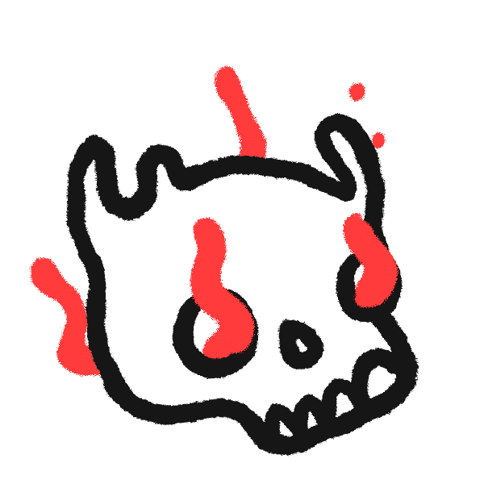
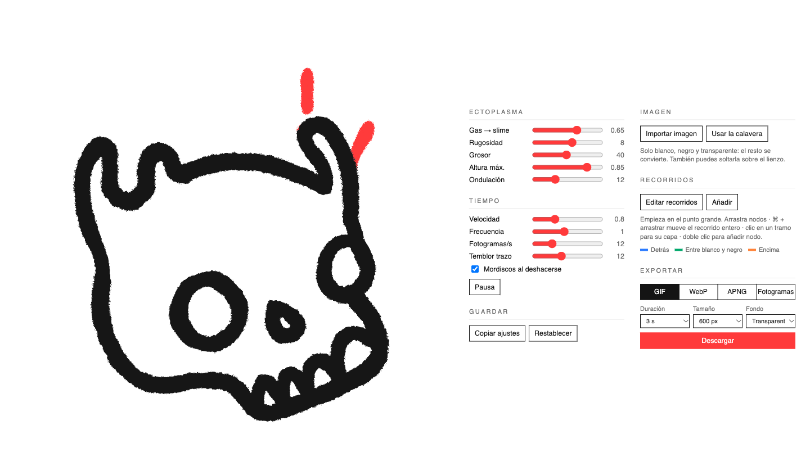

<div align="center">



# Slime Generator

**Ectoplasma animado a mano, sin dibujarlo a mano.**
Hilos de slime que nacen, se estiran, se parten en gotas y se deshacen a mordiscos,
con el temblor de línea de la animación tradicional.

Un único `index.html`. Sin instalar nada. Sin dependencias.

</div>

---

## Qué hace

Coges un dibujo en blanco y negro, le marcas por dónde sale el slime y la herramienta lo anima:
cada hilo crece desde su punto de nacimiento, forma un cuello, suelta una gota que sube y
acaba disolviéndose. Todo va a "dos fotogramas", con el trazo temblando como si estuviera
redibujado en cada uno.

Cuando te guste, lo descargas en **GIF**, **WebP animado**, **APNG** o como **secuencia de PNG**.

<p align="center"></p>

## Empezar

Abre `index.html` en el navegador. Ya está.

Si prefieres servirlo:

```sh
python3 -m http.server 8765
# → http://localhost:8765
```

## Cómo se usa

### 1 · Tu imagen
**Importar imagen** o arrástrala sobre el lienzo. Solo se admite **blanco, negro y transparente**:
cualquier otro color se convierte al más cercano y la herramienta te dice qué porcentaje ha cambiado.
El blanco y el negro se separan en dos capas, para que el slime pueda pasar *entre* el relleno y la línea.

### 2 · Los recorridos
Pulsa **Editar recorridos**. Cada recorrido empieza en el punto grande (donde nace el slime) y sigue sus nodos.

| Gesto | Qué hace |
|---|---|
| Arrastrar un nodo | Lo mueve |
| <kbd>⌘</kbd> / <kbd>Ctrl</kbd> + arrastrar | Mueve el recorrido entero |
| Clic en un tramo | Lo selecciona para cambiar su capa |
| Doble clic en un tramo | Añade un nodo ahí |

Cada tramo vive en una de tres capas:

- 🟦 **Detrás** — por detrás del dibujo
- 🟩 **Entre blanco y negro** — encima del relleno, debajo de la línea
- 🟧 **Encima** — por delante de todo

La línea discontinua marca el **techo**: hasta dónde puede subir el slime.

### 3 · El carácter del slime

| Control | Efecto |
|---|---|
| **Gas → slime** | A la izquierda, varias gotitas ligeras. A la derecha, una gota gorda con cuello elástico |
| **Rugosidad** | Borde liso o borde mordido |
| **Grosor** | Ancho del hilo |
| **Altura máx.** | Dónde está el techo |
| **Ondulación** | Cuánto serpentea |
| **Velocidad / Frecuencia** | Ritmo de cada hilo y cada cuánto nace uno nuevo |
| **Fotogramas/s** | 12 es el clásico "a dos" |
| **Temblor trazo** | El *line boil* de todo el dibujo |
| **Mordiscos** | Que se deshaga a bocados en vez de encogerse |

### 4 · Exportar

| Formato | Para qué |
|---|---|
| **GIF** | Compatible con todo. Paleta de 4 colores (rojo, blanco, negro, transparente) |
| **WebP** | Animado con transparencia suave y poco peso. Necesita Chrome o Edge para crearlo |
| **APNG** | PNG animado con transparencia real. Se crea en cualquier navegador |
| **Fotogramas** | Un `.zip` con un PNG por fotograma, para llevarlo a After Effects, Procreate… |

Eliges duración, tamaño (400–1200 px) y fondo transparente o blanco.

### Guardar
Los ajustes, los recorridos y la imagen importada se guardan solos en el navegador.
**Copiar ajustes** te da un JSON con todo, para compartirlo o versionarlo.

## Cómo funciona por dentro

- **Tres lienzos de slime** intercalados con las dos capas del dibujo: detrás, entre y encima.
- Cada hilo es una ristra de círculos a lo largo del recorrido. Un **filtro SVG "goo"**
  (desenfoque + umbral de alfa) los funde en una masa continua, y un `feTurbulence` le muerde el borde.
- Todo el conjunto pasa por un segundo filtro de desplazamiento cuyo *seed* cambia cada 150 ms: ese es el temblor del trazo.
- La exportación reconstruye cada fotograma como un SVG independiente con los mismos filtros,
  lo rasteriza y lo empaqueta con codificadores escritos a mano (LZW para GIF, contenedores RIFF y APNG, ZIP sin compresión).
  No hay librerías externas.

## Archivos

```
index.html     la herramienta completa
calavera.js    la calavera por defecto embebida (para que exportar funcione abriendo desde disco)
calavera-*.png la calavera original: relleno blanco y trazo negro
docs/          imágenes de este README
```

---

<div align="center">
<sub>Hecho para <b>Mololo</b> · 💀</sub>
</div>
